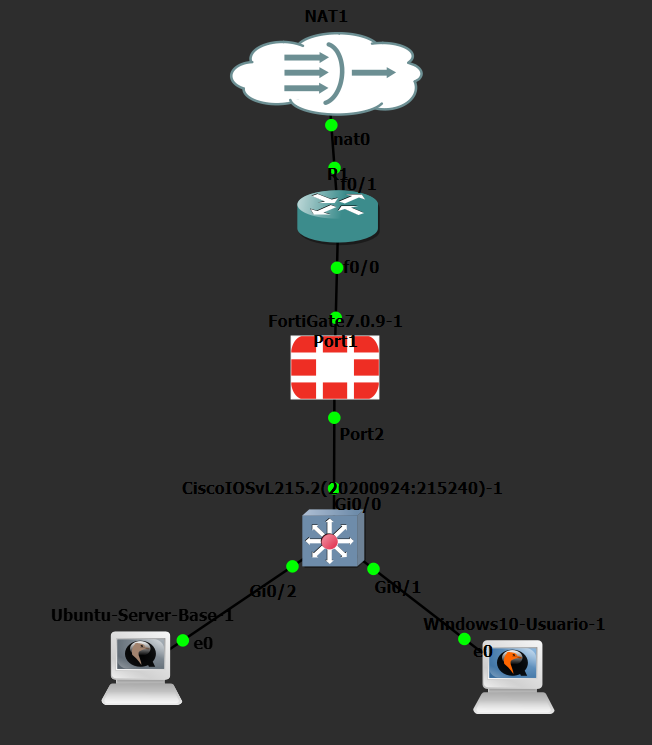
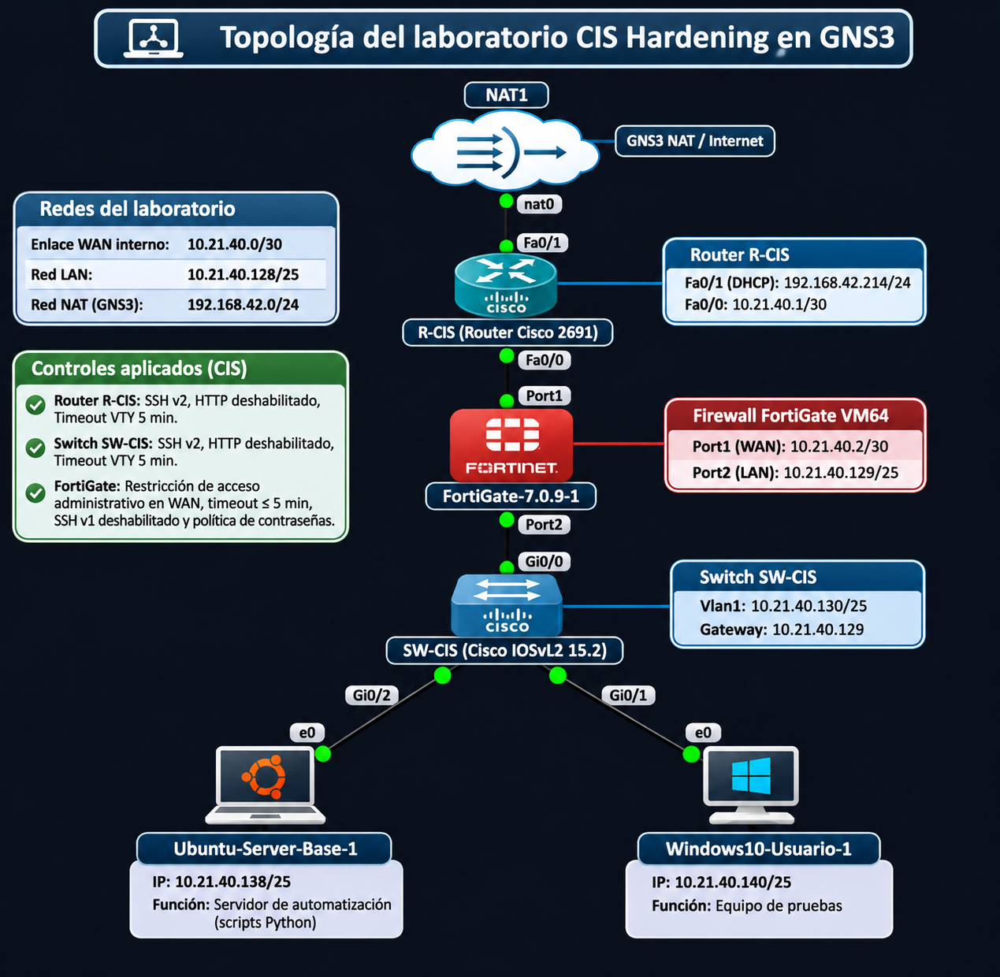

# Laboratorio de auditoría y hardening CIS en GNS3

**Práctica de Seguridad de Redes · GNS3 · Cisco IOS / IOSvL2 · FortiGate 7.0.9 · Ubuntu Server 24.04.5 · Python**

## 🎬 Video demostrativo

(https://www.youtube.com/watch?v=-5HhBZeciLk)
---

## 1. Introducción y propósito

Este laboratorio implementa una infraestructura virtual en **GNS3** para evaluar y fortalecer la seguridad de administración del **router Cisco R-CIS**, el **switch Cisco SW-CIS** y el **firewall FortiGate 7.0.9**. Un servidor Ubuntu utiliza **Python y Paramiko** para conectarse por SSH, verificar parámetros de configuración, registrar el estado de los dispositivos en archivos **JSON** y aplicar controles seleccionados de hardening.

La práctica toma como referencia **principios de seguridad alineados con CIS Benchmarks**, tales como reducir servicios administrativos expuestos, usar SSHv2, limitar sesiones inactivas y establecer contraseñas robustas.

### Objetivos

1. Implementar una topología con NAT, router, firewall, switch, Ubuntu Server y Windows 10.
2. Auditar **11 controles seleccionados**: tres del router, tres del switch y cinco del FortiGate.
3. Ejecutar scripts en modo `--audit` sin modificar la configuración.
4. Aplicar hardening con `--apply` cuando se requieran cambios y volver a verificar los controles.
5. Comparar los resultados iniciales y finales, conservar reportes JSON y comprobar la administración SSH.
6. Documentar los controles que no se pudieron completar sin afectar el acceso administrativo.

> **Alcance:** Los resultados representan únicamente estos 11 controles académicos, **no una certificación CIS ni el cumplimiento integral de un benchmark**. No se atribuyen números específicos de recomendación CIS sin comprobar su correspondencia con la edición y la versión del producto.

## 2. Topología de red





**Flujo:** NAT1 → Router R-CIS → FortiGate → Switch SW-CIS → Ubuntu Server y Windows 10 QEMU.

| Dispositivo | Función | Dirección IPv4 |
|---|---|---|
| NAT1 | Red NAT de salida del laboratorio | `192.168.42.0/24` |
| R-CIS, FastEthernet0/1 | WAN, dirección mediante DHCP | `192.168.42.214/24` (observada; puede variar) |
| R-CIS, FastEthernet0/0 | Enlace hacia FortiGate | `10.21.40.1/30` |
| FortiGate, port1 | WAN hacia R-CIS | `10.21.40.2/30` |
| FortiGate, port2 | Gateway de la LAN | `10.21.40.129/25` |
| SW-CIS, VLAN 1 | Administración del switch | `10.21.40.130/25` |
| Ubuntu Server, ens3 | Automatización Python / SSH | `10.21.40.138/25` |
| Windows 10 QEMU | Equipo de pruebas | `10.21.40.140/25` |

**Red de tránsito:** `10.21.40.0/30` · **Red LAN:** `10.21.40.128/25` · **Gateway LAN:** `10.21.40.129`.

[Consultar documentación detallada del direccionamiento](Direccionamiento/README.md).

## 3. Configuración del router R-CIS

**Equipo:** Cisco 2691 · IOS 12.4(25d) · **IP de enlace:** `10.21.40.1`.

### 3.1 Interfaces, enrutamiento y NAT

El router recibe su IP WAN desde NAT1 por DHCP, mantiene la red de tránsito hacia FortiGate y utiliza NAT overload para permitir la salida de la LAN. La ruta estática garantiza el retorno del tráfico hacia la subred `10.21.40.128/25`.

```cisco
interface FastEthernet0/1
 ip address dhcp
 ip nat outside
!
interface FastEthernet0/0
 ip address 10.21.40.1 255.255.255.252
 ip nat inside
!
ip route 10.21.40.128 255.255.255.128 10.21.40.2
ip nat inside source list 10 interface FastEthernet0/1 overload
```

**Comprobación:** `show ip interface brief`, `show ip route`, `show ip nat statistics`. La ACL utilizada para NAT puede consultarse en la configuración exportada.

### 3.2 SSH versión 2 y acceso VTY

El acceso remoto debe utilizar **SSHv2** y autenticación local, con las líneas VTY limitadas a SSH.

```cisco
ip ssh version 2
!
line vty 0 4
 login local
 transport input ssh
 exec-timeout 5 0
```

**Riesgo mitigado:** uso de protocolos de administración antiguos y sesiones abiertas sin supervisión.

**Comprobación:** `show ip ssh` y `show running-config | section line vty`.

### 3.3 Servidor HTTP deshabilitado

```cisco
no ip http server
no ip http secure-server
```

**Comprobación ejecutada:**

```cisco
R-CIS#show running-config | include ip http
```

**Salida observada:**

```text
no ip http server
no ip http secure-server
```

> En la auditoría inicial, HTTP **ya estaba deshabilitado**. Los controles que pasaron de «No cumple» a «Cumple» fueron SSH versión 2 y timeout VTY.

**Resultado del router:** **1/3 (33,33 %) → 3/3 (100 %)**.

[Ver running-config del router](Configuraciones/Show%20runnig-config%20R-CIS..txt) · [Script Python](Scripts/hardening_router.py.txt).

## 4. Configuración del switch SW-CIS

**Equipo:** Cisco IOSvL2 · IOS 15.2 · **IP de gestión:** `10.21.40.130/25`.

### 4.1 Interfaz de administración

```cisco
interface Vlan1
 ip address 10.21.40.130 255.255.255.128
!
ip default-gateway 10.21.40.129
```

El enlace con el FortiGate utiliza `Gi0/0`; el servidor Ubuntu está conectado a `Gi0/2` y Windows 10 a `Gi0/1`.

### 4.2 SSHv2, HTTP y timeout VTY

```cisco
ip ssh version 2
no ip http server
ip http secure-server
!
line vty 0 4
 login local
 transport input ssh
 exec-timeout 5 0
```

Los controles evitan la administración por HTTP sin cifrado, exigen SSH versión 2 y limitan la inactividad de una sesión VTY a cinco minutos.

**Comandos de verificación:**

```cisco
show ip ssh
show running-config | include ip http
show running-config | section line vty
show ip interface brief
```

La comprobación de HTTP devolvió:

```text
no ip http server
ip http secure-server
```

Esto confirma que **HTTP está deshabilitado** y que HTTPS permanece configurado en el switch.

**Resultado del switch:** **0/3 (0 %) → 3/3 (100 %)**.

[Ver running-config del switch](Configuraciones/Show%20runnig-config%20SW-CIS..txt) · [Script Python](Scripts/hardening_switch.py.txt).

## 5. Configuración del firewall FortiGate

**Equipo:** FortiGate VM · FortiOS 7.0.9 · **WAN:** `10.21.40.2/30` · **LAN:** `10.21.40.129/25`.

### 5.1 Interfaces WAN y LAN

En **Network → Interfaces** se revisaron las interfaces y sus accesos administrativos.

| Parámetro | port1 — WAN | port2 — LAN |
|---|---|---|
| Dirección | `10.21.40.2/30` | `10.21.40.129/25` |
| Función | Hacia router R-CIS | Hacia switch SW-CIS |
| Acceso administrativo final | `ping` | `ping https ssh http` |
| Control CIS seleccionado | Restricción WAN: **cumple** | HTTP LAN: **pendiente** |

**Configuración de referencia de la WAN:**

```fortios
config system interface
    edit "port1"
        set allowaccess ping
    next
end
```

Se restringieron los protocolos de administración remota en la WAN. En la LAN se conservó temporalmente HTTP porque el acceso por HTTPS presentaba un **fallo de negociación TLS**.

> **Control pendiente:** deshabilitar HTTP en `port2` solo después de reparar y comprobar HTTPS. No se marca como cumplido ni se oculta esta excepción.

### 5.2 Timeout y protocolo SSH

El FortiGate presentó los siguientes valores:

```fortios
config system global
    set admintimeout 5
    set admin-ssh-v1 disable
end
```

**Comprobación:** `get system global`, `show system global` y **System → Settings → Idle timeout**. Ambos controles **ya estaban cumplidos** durante la auditoría inicial.

### 5.3 Política de contraseñas de administradores

Se habilitó la política de contraseñas para la administración, con longitud mínima de **12 caracteres** y al menos una mayúscula, una minúscula, un número y un símbolo.

```fortios
config system password-policy
    set status enable
    set apply-to admin-password
    set minimum-length 12
    set min-upper-case-letter 1
    set min-lower-case-letter 1
    set min-number 1
    set min-non-alphanumeric 1
end
```

**Comprobación:** `show full-configuration system password-policy` y **System → Settings → Password Policy**.

**Observación del proceso:** hubo que habilitar primero la política y corregir manualmente la secuencia de parámetros durante la práctica; no se afirma que la remediación completa se haya realizado automáticamente sin incidencias.

### 5.4 Ruta estática y política LAN-A-INTERNET

La ruta predeterminada permite la salida hacia R-CIS:

| Destino | Gateway | Interfaz |
|---|---|---|
| `0.0.0.0/0` | `10.21.40.1` | `port1` |

La política **LAN-A-INTERNET** habilita el flujo de `port2` a `port1`:

| Parámetro | Configuración observada |
|---|---|
| Source / Destination | `all` / `all` |
| Schedule | `always` |
| Service | `ALL` |
| Action | `ACCEPT` |
| NAT | Deshabilitado (NAT lo realiza R-CIS) |
| Log | Tráfico registrado |

Estas configuraciones forman parte de la **conectividad**, no de los cinco controles seleccionados para la auditoría CIS.

**Resultado del FortiGate:** **2/5 (40 %) → 4/5 (80 %)**.

[Ver configuración exportada](Configuraciones/Configuracion%20Fortigate.txt) · [Capturas de GUI (PDF)](Configuracion%20FortiGate%20GUI/Configuracion_FortiGate_GUI.pdf) · [Script Python](Scripts/hardening_fortigate.py.txt).

## 6. Ubuntu Server y automatización de auditorías

### 6.1 Configuración de red estática

Ubuntu utiliza la interfaz `ens3` con `10.21.40.138/25`. El archivo `/etc/netplan/50-cloud-init.yaml` quedó configurado así:

```yaml
network:
  version: 2
  ethernets:
    ens3:
      dhcp4: false
      addresses:
        - 10.21.40.138/25
      routes:
        - to: default
          via: 10.21.40.129
      nameservers:
        addresses:
          - 8.8.8.8
          - 1.1.1.1
```

**Comprobación realizada:**

```bash
ip -br addr show ens3
ip route
```

**Resultado observado:** `ens3 UP 10.21.40.138/25` y ruta predeterminada vía `10.21.40.129`.

### 6.2 Preparación del entorno Python

Se utilizó **Ubuntu Server 24.04.5 LTS**, **Python 3.12.3** y **Paramiko 3.5.1**.

```bash
cd ~/CIS-Hardening-GNS3
source venv/bin/activate
python3 --version
python3 -m pip show paramiko
```

Los archivos originales ejecutados en Ubuntu tienen extensión `.py`. Las copias del repositorio se publicaron como `.py.txt`; **no deben ejecutarse directamente** sin restaurar y revisar el código, incluida cualquier línea de título añadida a los textos.

[Ver registro de configuración de Ubuntu](Scripts/scripts-servidor-ubuntu-cis-hardening.txt).

### 6.3 Scripts de auditoría y aplicación

**Modo `--audit`:** revisa controles y genera un reporte JSON sin realizar cambios de configuración.

```bash
python3 hardening_router.py --audit
python3 hardening_switch.py --audit
python3 hardening_fortigate.py --audit
```

**Modo `--apply`:** comprueba los controles, intenta aplicar remediaciones necesarias y vuelve a evaluar el dispositivo.

```bash
python3 hardening_router.py --apply
python3 hardening_switch.py --apply
python3 hardening_fortigate.py --apply
```

Los comandos corresponden a los scripts originales ejecutados en Ubuntu. **No es necesario ni recomendable volver a ejecutar `--apply` para preparar la documentación**, ya que puede modificar la configuración y sobrescribir reportes locales.

### 6.4 Ejecución real de `--apply` en el switch

En una comprobación posterior al hardening se ejecutó:

```bash
python3 hardening_switch.py --apply
```

**Salida observada:**

```text
Conectando a SW-CIS...
Conexion SSH establecida.

=== ESTADO INICIAL ===
SSH_V2: CUMPLE
HTTP_OFF: CUMPLE
TIMEOUT_VTY: CUMPLE
Controles cumplidos: 3/3
Cumplimiento seleccionado: 100.0%

No hay cambios pendientes.

=== ESTADO POSTERIOR ===
SSH_V2: CUMPLE
HTTP_OFF: CUMPLE
TIMEOUT_VTY: CUMPLE
Controles cumplidos: 3/3
Cumplimiento seleccionado: 100.0%

Todos los controles seleccionados cumplen.
```

Esta ejecución demuestra que el script **no aplica cambios innecesarios** cuando encuentra todos los controles cumplidos. No demuestra que haya remediado un incumplimiento durante esa ejecución.

**Verificación posterior:** `python3 hardening_switch.py --audit` confirmó nuevamente **3/3, 100 %**, sin alterar el switch.

### 6.5 Lectura de reportes almacenados

Para visualizar los archivos históricos sin modificar los dispositivos:

```bash
cd ~/CIS-Hardening-GNS3
python3 -m json.tool reportes/router_antes.json
python3 -m json.tool reportes/router_despues.json
python3 -m json.tool reportes/switch_antes.json
python3 -m json.tool reportes/switch_despues.json
python3 -m json.tool reportes/fortigate_antes.json
python3 -m json.tool reportes/fortigate_despues.json
```

> Ejecutar nuevamente una auditoría puede **sobrescribir reportes locales**, incluido el archivo `*_antes.json`. Los JSON de esta publicación preservan la medición histórica inicial para realizar la comparación.

## 7. Resultados y evidencias de funcionamiento

### 7.1 Comparación de cumplimiento

| Equipo | Auditoría inicial | Auditoría final | Cambio |
|---|---:|---:|---:|
| R-CIS | **1/3 (33,33 %)** | **3/3 (100 %)** | +2 |
| SW-CIS | **0/3 (0 %)** | **3/3 (100 %)** | +3 |
| FortiGate | **2/5 (40 %)** | **4/5 (80 %)** | +2 |
| **TOTAL** | **3/11 (27,3 %)** | **10/11 (90,9 %)** | **+7 controles** |

### 7.2 Resultado individual de controles

| Control evaluado | Antes | Después |
|---|---|---|
| Router — SSH versión 2 | No cumple | Cumple |
| Router — servidor HTTP deshabilitado | Cumple | Cumple |
| Router — timeout VTY cinco minutos | No cumple | Cumple |
| Switch — SSH versión 2 | No cumple | Cumple |
| Switch — servidor HTTP deshabilitado | No cumple | Cumple |
| Switch — timeout VTY cinco minutos | No cumple | Cumple |
| FortiGate — restringir administración WAN | No cumple | Cumple |
| FortiGate — deshabilitar HTTP en LAN | **No cumple** | **No cumple** |
| FortiGate — timeout administrativo | Cumple | Cumple |
| FortiGate — SSHv1 deshabilitado | Cumple | Cumple |
| FortiGate — política de contraseñas | No cumple | Cumple |

### 7.3 Pruebas y evidencias

| Prueba | Comando / pantalla | Resultado registrado |
|---|---|---|
| Auditoría inicial router | `router_antes.json` | 1/3 |
| Auditoría final router | `router_despues.json` | 3/3 |
| Auditoría inicial switch | `switch_antes.json` | 0/3 |
| Auditoría final switch | `switch_despues.json` | 3/3 |
| Auditoría inicial FortiGate | `fortigate_antes.json` | 2/5 |
| Auditoría final FortiGate | `fortigate_despues.json` | 4/5; HTTP LAN pendiente |
| Conexión SSH al router | `python3 test_ssh_router.py` | Conexión exitosa; respuesta de Cisco 2691 R-CIS |
| Auditoría en vivo del switch | `hardening_switch.py --audit` | SSH exitosa, 3/3; sin cambios |
| Aplicación sin cambios pendientes | `hardening_switch.py --apply` | 3/3 antes y después |
| HTTP en router | `show running-config \| include ip http` | `no ip http server` |
| HTTP en switch | `show running-config \| include ip http` | `no ip http server` |
| WAN FortiGate | Network → Interfaces → port1 | Solo PING |
| LAN FortiGate | Network → Interfaces → port2 | HTTP conservado por fallo de HTTPS |
| Contraseñas FortiGate | System → Settings → Password Policy | Admin; 12 caracteres y complejidad |
| Ruta FortiGate | Network → Static Routes | Default `0.0.0.0/0` vía `10.21.40.1` |
| Política FortiGate | Policy & Objects → Firewall Policy | LAN-A-INTERNET, ACCEPT |

La conexión SSH al router confirma acceso funcional; el cumplimiento específico de SSHv2 se sustenta también en los reportes y running-config. Las salidas de `show running-config` confirman el estado configurado de HTTP, pero **no son por sí solas una prueba TCP independiente de los puertos**.

📷 **[Abrir informe consolidado de evidencias con capturas auténticas (PDF)](Evidencias/Evidencias_CIS_Hardening.pdf)**.

📷 **[Abrir configuración del FortiGate por interfaz gráfica (PDF)](Configuracion%20FortiGate%20GUI/Configuracion_FortiGate_GUI.pdf)**.

> **Nota de presentación:** los procedimientos, resultados, comandos, explicaciones y conclusiones están **directamente en este README**, como indicó el profesor. Las capturas adicionales están consolidadas en los PDF, todavía no incrustadas individualmente en Markdown.

### 7.4 Reportes de auditoría disponibles

| Dispositivo | Inicial | Final |
|---|---|---|
| Router | [router_antes.json](Reportes/router_antes.json) | [router_despues.json](Reportes/router_despues.json) |
| Switch | [switch_antes.json](Reportes/switch_antes.json) | [switch_despues.json](Reportes/switch_despues.json) |
| FortiGate | [fortigate_antes.json](Reportes/fortigate_antes.json) | [fortigate_despues.json](Reportes/fortigate_despues.json) |

También se conserva un [reporte intermedio del FortiGate (3/5)](Reportes/fortigate_antes_original.json). **No sustituye al resultado inicial de 2/5.**

## 8. Conclusiones

La práctica alcanzó un aumento de cumplimiento de **3/11 a 10/11 controles**, equivalente a **27,3 % → 90,9 %** del conjunto seleccionado. Router y switch finalizaron cumpliendo los tres controles de cada uno. FortiGate cumplió cuatro de cinco, con una excepción técnica documentada.

Los scripts y sus reportes permitieron comparar resultados antes y después, mantener evidencia verificable y confirmar mediante SSH que los dispositivos continuaban accesibles. El control HTTP del FortiGate no se forzó hasta asegurar HTTPS, priorizando la recuperación del acceso administrativo frente a una remediación que pudiera causar bloqueo.

**Conclusión principal:** la auditoría y el hardening deben combinar configuración segura, comprobación posterior y documentación honesta de los controles pendientes.

## 9. Seguridad y alcance

- Los **11 controles** representan una selección académica, no una evaluación integral ni certificación CIS.
- El FortiGate mantiene HTTP administrativo en `port2`; el control sigue pendiente mientras se investiga HTTPS/TLS.
- El modo `--apply` puede efectuar cambios reales; debe utilizarse con acceso autorizado y posibilidad de recuperación por consola.
- Las copias `.py.txt` son documentación del código. Antes de reproducirlo, deben revisarse los scripts como archivos Python válidos y sus dependencias.
- Una exportación completa de FortiGate puede incluir valores `ENC`, hashes y secretos. **La exportación pública del laboratorio debe depurarse y deben protegerse las credenciales expuestas**, incluso si sus valores aparecen cifrados.
- Se recomienda revisar configuración de administradores, NTP, registros centralizados, restricciones de origen, MFA y otras recomendaciones aplicables para una siguiente versión del laboratorio.

**Documentación técnica de controles:** [Recomendaciones CIS](Documentacion/Recomendaciones_CIS.md).

## 10. Archivos complementarios

| Recurso | Enlace |
|---|---|
| Topología GNS3 | [Captura](Topologia/Topologia.png) · [Diagrama](Topologia/Diagrama.png) |
| Direccionamiento IP | [README de direccionamiento](Direccionamiento/README.md) |
| Script del router | [hardening_router.py.txt](Scripts/hardening_router.py.txt) |
| Script del switch | [hardening_switch.py.txt](Scripts/hardening_switch.py.txt) |
| Script del FortiGate | [hardening_fortigate.py.txt](Scripts/hardening_fortigate.py.txt) |
| Preparación Ubuntu | [Registro de comandos](Scripts/scripts-servidor-ubuntu-cis-hardening.txt) |
| Running-config R-CIS | [Archivo](Configuraciones/Show%20runnig-config%20R-CIS..txt) |
| Running-config SW-CIS | [Archivo](Configuraciones/Show%20runnig-config%20SW-CIS..txt) |
| Exportación FortiGate | [Archivo](Configuraciones/Configuracion%20Fortigate.txt) |
| Reportes | [JSON antes/después](Reportes/) |
| Documentación CIS | [Recomendaciones CIS](Documentacion/Recomendaciones_CIS.md) |
| GUI del FortiGate | [PDF con capturas](Configuracion%20FortiGate%20GUI/Configuracion_FortiGate_GUI.pdf) |
| Evidencias | [PDF con capturas auténticas](Evidencias/Evidencias_CIS_Hardening.pdf) |

**Herramientas:** GNS3 · Cisco 2691 / IOS 12.4 · Cisco IOSvL2 15.2 · FortiOS 7.0.9 · Ubuntu Server 24.04.5 · Python 3.12.3 · Paramiko 3.5.1 · Windows 10 QEMU.

**Referencias:** [CIS Benchmarks](https://www.cisecurity.org/cis-benchmarks) · [Documentación oficial de FortiOS](https://docs.fortinet.com/) · [Recomendaciones del laboratorio](Documentacion/Recomendaciones_CIS.md).
